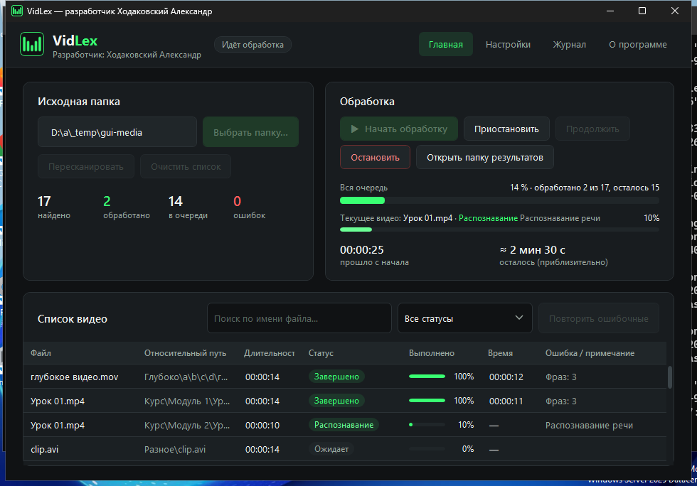
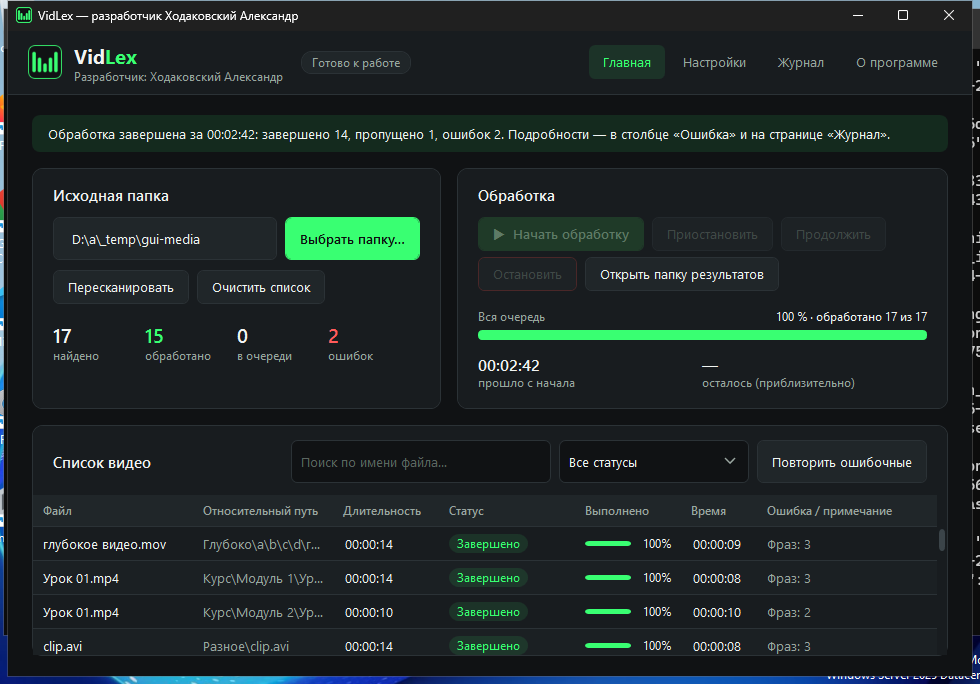
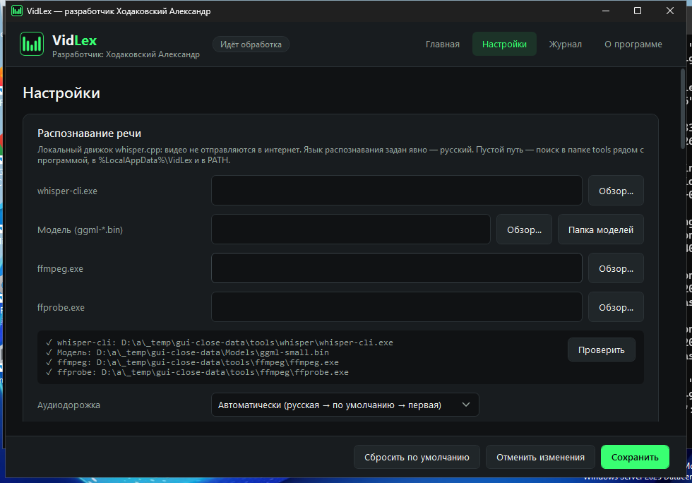
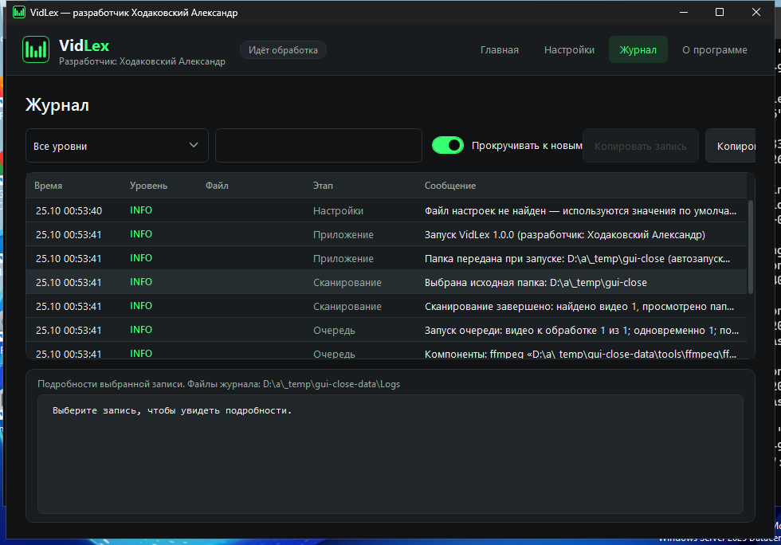
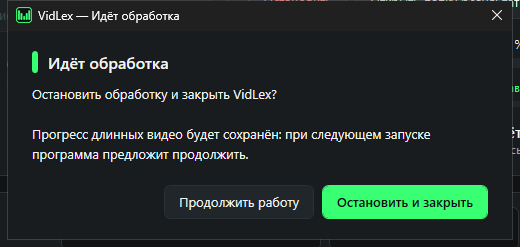
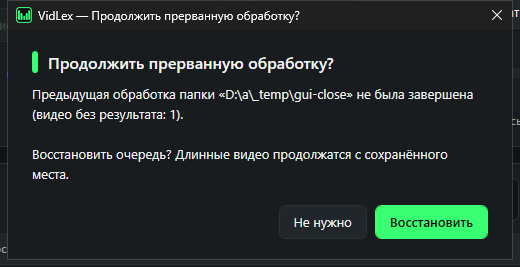

# VidLex

**VidLex** — настольное приложение для Windows, которое транскрибирует русскоязычные видео в текст.
Программа рекурсивно находит видео в выбранной папке и всех вложенных каталогах, распознаёт русскую речь
локально (без отправки данных в интернет), оформляет текст: пунктуация, разбиение на предложения,
безопасная проверка орфографии. Результат сохраняется в TXT (UTF-8).

**Разработчик:** Ходаковский Александр
**Платформа:** Windows 10/11 x64, .NET Framework 4.8, WPF
**Распознавание:** [whisper.cpp](https://github.com/ggml-org/whisper.cpp) (модели OpenAI Whisper), язык задан явно — русский
**Аудио:** FFmpeg

## Возможности

- Рекурсивный поиск видео: MP4, MKV, AVI, MOV, WMV, WebM, MPEG, MPG, M4V, FLV, TS, 3GP. Фактическая поддержка
  определяется декодером FFmpeg: повреждённые файлы получают статус «Ошибка» с понятным пояснением.
- Очередь заданий с настоящей паузой: процессы FFmpeg и whisper.cpp замораживаются средствами ОС. Также есть
  остановка, повтор ошибочных заданий и параллельная обработка (по умолчанию — последовательная).
- Длинные записи делятся на фрагменты по паузам речи. На стыках без паузы фрагменты перекрываются,
  а дубли на перекрытии убираются выравниванием слов.
- Постобработка: пробелы и повторяющиеся знаки, разделение слитных фраз («…программу далее рассмотрим…» →
  «…программу. Далее рассмотрим…»), пунктуация на границах сегментов с учётом пауз, словарь ru_RU (Hunspell)
  с исправлением только однозначных опечаток, пользовательский словарь, фильтр типичных «галлюцинаций» Whisper.
- Временные метки `[00:00:12]` можно включать и отключать (по умолчанию выключены), их период настраивается.
- Сохранение рядом с видео (по умолчанию) или в одну папку без подпапок с защитой от конфликтов имён;
  политика для существующих TXT; атомарная запись через временный файл.
- Прогресс текущего видео и всей очереди, прошедшее время и приблизительный остаток по фактической
  скорости обработки (до накопления данных показывается «Расчёт времени…»).
- Журнал (INFO/WARNING/ERROR, DEBUG — по желанию) с ежедневной ротацией и ограничением размера.
- Восстановление после сбоя: прерванная очередь и прогресс длинных видео продолжаются при следующем запуске.

## Интерфейс

Скриншоты сняты автоматически на Windows-раннере GitHub Actions (экран 1024×768).

| Обработка папки | Итог |
| --- | --- |
|  |  |
| **Настройки** | **Журнал** |
|  |  |
| **Закрытие во время обработки** | **Восстановление очереди** |
|  |  |

## Быстрый старт

1. Установите компоненты (FFmpeg, whisper.cpp, модель):
   ```powershell
   powershell -ExecutionPolicy Bypass -File scripts\Install-Dependencies.ps1
   ```
2. Запустите `VidLex.exe`, нажмите «Выбрать папку…», затем «Начать обработку».

Подробно — в [docs/INSTALL.md](docs/INSTALL.md).

## Документация

| Документ | Содержание |
| --- | --- |
| [docs/INSTALL.md](docs/INSTALL.md) | Установка, модели, сборка из исходников, запуск |
| [docs/ARCHITECTURE.md](docs/ARCHITECTURE.md) | Архитектура, выбор технологий, структура проекта, алгоритмы |
| [docs/TESTING.md](docs/TESTING.md) | Тесты, их результаты, известные ограничения |

## Структура репозитория

```
VidLex/
├── VidLex.sln
├── Directory.Build.props          общие свойства сборки (версия, авторство)
├── src/
│   ├── VidLex.Core/               ядро без UI (net48 + net8.0): сервисы, модели, интеграции
│   └── VidLex.App/                WPF-приложение (.NET Framework 4.8), MVVM
├── tools/VidLex.Cli/              консольный запуск конвейера (пакетная обработка, сквозные тесты)
├── tests/
│   ├── VidLex.Core.Tests/         модульные тесты (xUnit)
│   └── e2e/                       сквозные тесты с настоящим FFmpeg и whisper.cpp
├── scripts/                       установка компонентов, сборка релиза, CI
└── docs/
```

## Лицензии компонентов

whisper.cpp — MIT; модели Whisper — MIT (OpenAI); FFmpeg — LGPL (скрипт загружает LGPL-сборку);
словарь ru_RU — BSD (А. И. Лебедев); WeCantSpell.Hunspell — MPL 1.1/GPL 2.0/LGPL 2.1;
Newtonsoft.Json — MIT; Ookii.Dialogs.Wpf — BSD-3-Clause.
